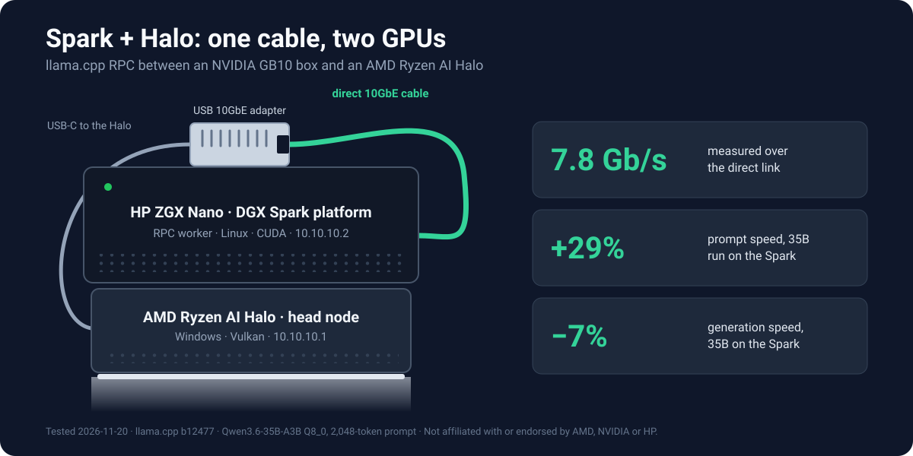
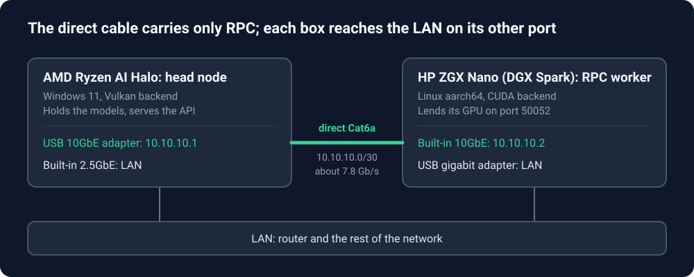

# Linking an HP ZGX Nano (NVIDIA DGX Spark platform) and an AMD Ryzen AI Halo for llama.cpp RPC

Version 1.2.4 · tested 2026-11-20



## What this is

An AMD Ryzen AI Halo (Windows, Vulkan) can drive an HP ZGX Nano G1n (Linux, CUDA) as a llama.cpp RPC worker over one direct 10GbE cable. The ZGX Nano is HP's build of the NVIDIA DGX Spark platform, so it is called "the Spark" from here on, and the steps should carry over to other DGX Spark systems. The Halo holds the models and serves the API; the Spark lends its GPU when it is connected.

Measured on this setup on 2026-11-20:

- The link carries 7.7 to 7.9 Gb/s in both directions with zero retransmits.
- With a 35B model running entirely on the Spark and driven from the Halo, prompt processing was 14 to 29% faster than the Halo alone, and generation was 7% slower.
- The Spark's GPU is faster run natively than through RPC. A `llama-server` on the Spark, called from the Halo over the same cable, generated at 60.8 tokens per second against 51.1 through RPC. RPC is for pooling memory, not for raw speed.
- On the Halo itself, a larger micro-batch made long prompts 24% faster, Vulkan beat ROCm, and multi-token prediction added 40 to 45% to generation but made temperature-0 answers depend on what the server had answered before.
- Splitting a model that fits on one box cost 12% on generation. Splitting is for models too large for either box.

When this was written I could find published llama.cpp RPC clusters of Spark with Spark, Halo with Halo, and Spark with Mac, but no write-up pairing a Spark with a Strix Halo machine. If one exists, I missed it.

Everything below was run on real hardware. Commands are shown as they were used, with addresses you should change marked as such. Anything not run exactly as written is labeled.

## Parts list

| Part | What was used | Notes |
| --- | --- | --- |
| RPC worker | HP ZGX Nano G1n (NVIDIA GB10, the DGX Spark platform), 128 GB unified memory, DGX OS on Ubuntu 24.04, aarch64 | Built-in 10GbE is a Realtek chip using the `r8127` driver. The two QSFP ports are not used. |
| Head node | AMD Ryzen AI Halo developer platform, Ryzen AI Max+ 395, Radeon 8060S, 128 GB, Windows 11 Pro | Memory split 96 GB GPU / 32 GB system. Built-in Ethernet (a Realtek port whose driver offers up to 2.5 Gbps) stays on the LAN. |
| 10GbE adapter for the Halo | WAVLINK WL-NWU343G, USB-C, Realtek RTL8159 | Shows up as USB `0BDA:815A`, "Realtek USB 10GbE Family Controller". Driver 1159.23.20.605. |
| LAN adapter for the Spark | Any USB-C gigabit adapter with a Realtek RTL8153 | Shows up as USB `0BDA:8153`. Uses the in-kernel `r8152` driver, nothing to install. |
| Cable | One short Cat6a patch cable | Direct, no switch. |

Why this shape: each box has one RJ-45 port (10GbE on the Spark, 2.5GbE on the Halo) and each needs two network paths, LAN and direct link. The Spark's USB-C ports are USB 3.2 Gen 2x2, not USB4 or Thunderbolt, so a Thunderbolt-class 10GbE adapter will not work there. The Halo has USB4 ports, so the fast adapter goes on the Halo and the Spark gives up its built-in port to the direct link.

## Topology



| Path | Halo | Spark |
| --- | --- | --- |
| Direct link, 10.10.10.0/30 | USB 10GbE adapter, 10.10.10.1 | Built-in 10GbE, 10.10.10.2 |
| LAN | Built-in 2.5GbE | USB gigabit adapter |

The direct link has no gateway and no DNS on either end. A direct cable was chosen over the LAN for two reasons: the RPC server has no authentication, and in this network the two boxes sat on different subnets, so their traffic was being routed through the firewall.

## Step 1: Spark

The Spark's built-in 10GbE port becomes the direct link, so its LAN address has to move to the USB gigabit adapter first. Do this in order, or you can lock yourself out of SSH.

1. Plug in the USB gigabit adapter and confirm the driver and speed. You want `Driver=r8152` at `5000M`.

    ```
    lsusb -t | grep -i -B2 r8152
    ip -br link
    ```

2. Cable the adapter to the same network the built-in port is on. Check how the current address is assigned (`ipv4.method` of `auto` means DHCP).

    ```
    nmcli device status
    nmcli -f ipv4.method,ipv4.addresses,ipv4.gateway,ipv4.dns con show "<current connection>"
    ```

3. Create a static profile on the adapter, with auto-connect off so it cannot clash yet. Replace the address, prefix, gateway and DNS with your LAN's values.

    ```
    sudo nmcli con add type ethernet ifname <usb-adapter> con-name lan-usb ipv4.method manual ipv4.addresses <lan-ip>/<prefix> ipv4.gateway <gateway> ipv4.dns <dns> connection.autoconnect no
    ```

4. Swap in one detached command. It pings the gateway over the new adapter and puts the old profile back if that fails.

    ```
    sudo sh -c 'nohup sh -c "nmcli con down \"<current connection>\"; nmcli con up lan-usb; sleep 5; ping -c 3 -I <usb-adapter> <gateway> || { nmcli con down lan-usb; nmcli con up \"<current connection>\"; }" >/tmp/nicswap.log 2>&1 &'
    ```

5. Reconnect over SSH, then make it permanent.

    ```
    sudo nmcli con mod lan-usb connection.autoconnect yes connection.autoconnect-priority 10
    sudo nmcli con mod "<current connection>" connection.autoconnect no
    ```

6. Give the built-in 10GbE port its point-to-point address. No gateway, so it never competes with the LAN route.

    ```
    sudo nmcli con add type ethernet ifname <10gbe-port> con-name halo-direct ipv4.method manual ipv4.addresses 10.10.10.2/30 ipv4.never-default yes ipv6.method disabled connection.autoconnect yes
    ```

If the LAN address was handed out by DHCP, reserve or exclude it on your router so nothing else receives it. The profile comes up by itself as soon as the port sees a link.

### The NIC swap in detail

This is the part most likely to go wrong, because the address being moved is the one your SSH session is using. Here is what it looked like on this Spark. The adapter's MAC is shortened and the LAN addresses are randomly generated stand-ins; the direct-link addresses (10.10.10.x) are the real ones, since you can reuse them as they are.

**Why swap at all.** The Spark has one 10GbE RJ-45 port and it was carrying the LAN. The direct link needs that port, so the LAN moves to a 1 Gb USB adapter. That costs nothing in practice: model weights and RPC traffic use the direct link, and the LAN side only carries SSH, updates and the occasional file copy.

**1. The adapter is recognized.** An RTL8153 needs no driver install on DGX OS.

```
$ lsusb
Bus 006 Device 002: ID 0bda:8153 Realtek Semiconductor Corp. RTL8153 Gigabit Ethernet Adapter

$ lsusb -t | grep -i -B2 r8152
/:  Bus 006.Port 001: Dev 001, Class=root_hub, Driver=xhci-hcd/1p, 20000M/x2
    |__ Port 001: Dev 002, If 0, Class=Vendor Specific Class, Driver=r8152, 5000M
```

`Driver=r8152` at `5000M` is what you want. `480M` means it landed on a USB 2 path; try another port or cable. The `20000M/x2` on the root hub is the Spark's USB 3.2 Gen 2x2 port.

**2. Look before you move anything.** Two assumptions were wrong here, and both would have broken the swap.

```
$ nmcli device status
DEVICE           TYPE      STATE         CONNECTION
enP7s7           ethernet  connected     Wired connection 3
enxAABBCCDDEEFF  ethernet  unavailable   --

$ nmcli -f ipv4.method con show "Wired connection 3"
ipv4.method:    auto

$ ip -br addr show enP7s7
enP7s7    UP    10.247.90.94/27
```

- The address was not set on the Spark. `auto` means the router was handing it out by DHCP to the built-in port's MAC.
- The subnet was a /27, not a /24. Copy the prefix, gateway and DNS from what the box reports; do not guess them.
- `unavailable` on the adapter just means no cable yet.

**3. Cable the adapter to the same network.** It picked up its own temporary DHCP address on an auto-created profile, so for a moment the Spark was reachable on two addresses. That is harmless and useful: it proves the adapter and switch port work before anything is taken away.

```
enP7s7           UP    10.247.90.94/27
enxAABBCCDDEEFF  UP    10.247.90.79/27
```

**4. Create the new profile with auto-connect off.** If it auto-connected now, both ports would claim the same address.

```
sudo nmcli con add type ethernet ifname enxAABBCCDDEEFF con-name lan-usb ipv4.method manual ipv4.addresses 10.247.90.94/27 ipv4.gateway 10.247.90.65 ipv4.dns 10.247.90.65 connection.autoconnect no
```

**5. Swap in one detached command.** It runs to completion even if the SSH session stalls, tests the gateway over the adapter, and puts the old profile back if the test fails.

```
sudo sh -c 'nohup sh -c "nmcli con down \"Wired connection 3\"; nmcli con up lan-usb; sleep 5; ping -c 3 -I enxAABBCCDDEEFF 10.247.90.65 || { nmcli con down lan-usb; nmcli con up \"Wired connection 3\"; }" >/tmp/nicswap.log 2>&1 &'
```

The session freezes for a few seconds while the network learns the address has a new MAC, then carries on. Check `/tmp/nicswap.log` if it does not.

**6. Make it stick, and stop the old profile reclaiming the address at boot.**

```
sudo nmcli con mod lan-usb connection.autoconnect yes connection.autoconnect-priority 10
sudo nmcli con mod "Wired connection 3" connection.autoconnect no
```

The priority matters: the auto-created profile from step 3 is still tied to the adapter, and `lan-usb` has to win over it.

**7. Confirm.** The adapter holds the address, the built-in port has none, and the default route leaves through the adapter.

```
$ ip -br addr
enP7s7           UP
enxAABBCCDDEEFF  UP    10.247.90.94/27

$ ip route
default via 10.247.90.65 dev enxAABBCCDDEEFF proto static metric 100
```

**8. Tidy up.**

- Unplug the LAN cable from the built-in 10GbE port. That port now belongs to the direct link.
- On the router, move the fixed-address entry to the adapter's MAC, or exclude the address from the DHCP pool. It was a DHCP address before and is static now, so without this the router may hand it to something else.
- Reboot once while you are near the machine to confirm `lan-usb` comes up unaided.

**If it goes wrong.** Until step 6, a reboot brings the old profile back on the built-in port. Keep a monitor and keyboard within reach for the swap anyway.

## Step 2: Halo

The Halo keeps its built-in port on the LAN and gets the USB 10GbE adapter for the direct link. Run everything in an elevated PowerShell. `scripts/Set-HaloDirect.ps1` does items 3, 4 and 6 in one run.

1. Plug the adapter into a USB4 port. Windows bound a working Realtek driver by itself here (1159.23.20.605). If yours does not, install Realtek's USB Ethernet package for Windows 11 (the NetAdapterCx installer) from realtek.com. The vendor's download is the same Realtek package under another name.

2. Connect the cable to the Spark **before** setting the address. Windows will not switch an adapter from DHCP to static while it has no link.

3. Rename the adapter and set the address. No gateway and no DNS.

    ```
    Rename-NetAdapter -Name "<new adapter name>" -NewName HaloDirect
    netsh interface ipv4 set address name=HaloDirect source=static address=10.10.10.1 mask=255.255.255.252 store=persistent
    netsh interface ipv4 set dnsservers name=HaloDirect source=static address=none register=none validate=no
    Disable-NetAdapterBinding -Name HaloDirect -ComponentID ms_tcpip6
    ```

4. Allow the Spark in. The direct link lands in the Public firewall profile, which blocks ping and `iperf3` by default.

    ```
    New-NetFirewallRule -DisplayName "HaloDirect - allow Spark" -Direction Inbound -Action Allow -RemoteAddress 10.10.10.2 -Profile Any
    ```

5. Stop Windows from sleeping the box or the adapter.

    ```
    powercfg /setactive 8c5e7fda-e8bf-4a96-9a85-a6e23a8c635c
    powercfg /change standby-timeout-ac 0
    powercfg /setacvalueindex SCHEME_CURRENT 2a737441-1930-4402-8d77-b2bebba308a3 48e6b7a6-50f5-4782-a5d4-53bb8f07e226 0
    powercfg /setactive SCHEME_CURRENT
    ```

    The first line selects High performance, the second disables sleep on AC power, the last two turn off USB selective suspend.

6. Confirm.

    ```
    Get-NetAdapter HaloDirect | Format-Table Name,Status,LinkSpeed
    ping 10.10.10.2
    ```

    Expect `Up`, `10 Gbps` and replies.

## Step 3: Verify the link

Both ends negotiated 10 Gbps. Measure real throughput with `iperf3` before changing any setting, so you have a baseline.

On the Halo, `winget install --id ar51an.iPerf3 -e`. On the Spark, `sudo apt-get install -y iperf3` (not run here, because a no-root copy was used instead).

```
# Spark
iperf3 -s -B 10.10.10.2

# Halo
iperf3 -c 10.10.10.2 -B 10.10.10.1 -t 10
iperf3 -c 10.10.10.2 -B 10.10.10.1 -t 10 -P 4
iperf3 -c 10.10.10.2 -B 10.10.10.1 -t 10 -R
iperf3 -c 10.10.10.2 -B 10.10.10.1 -t 10 -R -P 4
```

| Test | Result |
| --- | --- |
| Halo to Spark, 1 stream | 7.93 Gb/s |
| Halo to Spark, 4 streams | 7.83 Gb/s |
| Spark to Halo, 1 stream | 7.70 Gb/s |
| Spark to Halo, 4 streams | 7.73 Gb/s |

One stream matches four, so the ceiling is the USB side of the adapter, not CPU or TCP. MTU was 1500 on both ends; jumbo frames were not tested.

Latency depends on how busy the link is. At 5 to 100 pings per second the round trip averaged about 1.6 ms; at 500 per second it averaged 0.4 ms with a 0.1 ms minimum. That pattern suggests a batching timer of 2 to 3 ms in one of the two network chips. Three adapter settings were tried on the Halo (USB Transmit Burst Level, Miscellaneous Transfer Settings, Receive Segment Coalescing) and none changed it, so they were set back to defaults. The cost in practice is visible in the results: the RPC hop costs more on generation than on prompts.

## Step 4: Matching llama.cpp builds

The RPC protocol is not versioned, so both ends must be built from the same commit. This setup used build 12477, commit `054a1babf`.

**Halo.** The prebuilt Windows Vulkan build used here already contained `ggml-rpc.dll`, `ggml-rpc-server.exe` and `llama-bench.exe`. Check what you have:

```
llama-server.exe --version
```

**Spark.** Build the same tag with CUDA and RPC in its own folder, so any existing install is left alone. A git worktree keeps it separate from your main checkout.

```
cd ~/llama.cpp
git fetch --tags origin
git worktree add --detach ~/llama.cpp-b12477 refs/tags/b12477
cd ~/llama.cpp-b12477
cmake -B build-rpc -DCMAKE_BUILD_TYPE=Release -DGGML_CUDA=ON -DGGML_RPC=ON -DCMAKE_CUDA_ARCHITECTURES=121 -DCMAKE_CUDA_COMPILER=/usr/local/cuda/bin/nvcc -DLLAMA_CURL=OFF
cmake --build build-rpc --config Release -j 12
```

The build took under ten minutes on 12 of the Spark's 20 cores. `CMAKE_CUDA_ARCHITECTURES=121` targets the GB10. Confirm both ends report the same build and commit:

```
cd ~/llama.cpp-b12477/build-rpc/bin
LD_LIBRARY_PATH=. ./llama-server --version
```

Note the name: recent builds call the worker `ggml-rpc-server`, older guides say `rpc-server`.

## Step 5: Start the worker and benchmark

Start the RPC worker on the Spark, bound to the direct-link address only.

```
cd ~/llama.cpp-b12477/build-rpc/bin
LD_LIBRARY_PATH=. ./ggml-rpc-server --host 10.10.10.2 --port 50052
```

It prints the CUDA device and free memory, then listens. Add `-c` to cache received weights on the Spark, which makes later loads of the same model faster.

Measured with `-c` and the 35B model: the worker stored about 34 GB under `~/.cache/llama.cpp/rpc`. The first load plus benchmark took 132 seconds and the next took 88.

On the Halo, confirm the head node sees both devices:

```
llama-bench.exe --rpc 10.10.10.2:50052 --list-devices
```

```
Available devices:
  Vulkan0: AMD Radeon(TM) 8060S Graphics (114597 MiB, 108867 MiB free)
  RPC0: 10.10.10.2:50052 (124546 MiB, 78326 MiB free)
```

Then run the same benchmark three ways. The model file stays on the Halo; the worker needs no copy.

```
# A. Halo only
llama-bench.exe -m <model.gguf> -ngl 99 -p 512,2048 -n 128 -r 2

# B. Split across both (llama.cpp chooses the split)
llama-bench.exe -m <model.gguf> --rpc 10.10.10.2:50052 -ngl 99 -p 512,2048 -n 128 -r 2

# C. Everything on the Spark, driven from the Halo
llama-bench.exe -m <model.gguf> --rpc 10.10.10.2:50052 --device RPC0 -ngl 99 -p 512,2048 -n 128 -r 2
```

A server takes the same flags, and a one-request test with the 4B model answered correctly. On `llama-server.exe`: add `--rpc 10.10.10.2:50052`, and `--device RPC0` to place the whole model on the Spark.

## Results

Each model was run four ways: on the Halo alone, entirely on the Spark through RPC, split across both, and natively on the Spark with no RPC as a reference. Command: `llama-bench -ngl 99 -p 512,2048 -n 128 -r 2`. All figures are tokens per second.

**Qwen3.6-35B-A3B at Q8_0 (35.2 GiB)**

| Where the model runs | Prompt, 512 tokens | Prompt, 2,048 tokens | Generation |
| --- | --- | --- | --- |
| Halo only, Vulkan | 1,689 ± 7 | 1,635 ± 16 | 55.2 ± 0.0 |
| Spark only, over RPC | 1,922 ± 71 | 2,111 ± 29 | 51.1 ± 0.6 |
| Split, Vulkan + RPC | 1,728 ± 47 | 2,582 ± 46 | 48.7 ± 0.1 |
| Spark native, CUDA, no RPC | 2,250 ± 6 | 2,259 ± 22 | 61.7 ± 0.1 |

The same 35B as a server, one request generating 400 tokens at temperature 0:

| Server | Generation |
| --- | --- |
| `llama-server` on the Halo, Vulkan | 52.7 |
| `llama-server` on the Spark, CUDA, called from the Halo over the direct link | 60.8 |

**Qwen3.5-4B at Q6_K (3.27 GiB)**

| Where the model runs | Prompt, 512 tokens | Generation |
| --- | --- | --- |
| Halo only, Vulkan | 1,789 ± 5 | 53.7 ± 0.4 |
| Spark only, over RPC | 4,299 ± 7 | 51.5 ± 0.1 |
| Split, Vulkan + RPC | 2,168 ± 99 | 48.6 ± 0.1 |
| Spark native, CUDA, no RPC | 4,611 ± 43 | 57.6 ± 0.0 |

- **The Spark is the faster GPU for both models.** Natively it generated the 35B 12% faster than the Halo and processed prompts 33 to 38% faster.
- **RPC keeps part of that advantage.** Driven from the Halo, the 35B gained 14% on a 512-token prompt and 29% on a 2,048-token prompt, and lost 7% on generation.
- **The RPC hop has a price.** Against the Spark's own native numbers, going through RPC cost 7 to 15% on prompts and 17% on generation for the 35B.
- **Small models exaggerate the prompt gain.** The 4B processed prompts 2.4 times faster on the Spark; the 35B gained far less.
- **The split is uneven.** On the 35B it gave the fastest long-prompt result (58% above the Halo alone) and the slowest generation (12% below). On a 512-token prompt it gained 2%.
- **Practical reading.** If a model fits on the Spark, run its server there and call it over the direct link. That delivered the Spark's full native speed, 15% above the Halo's own server and 19% above RPC. RPC earns its place when a model needs both machines' memory.

Limits of this data: two repetitions per test, and both machines were holding other models in GPU memory while the tests ran (about 36 GB on the Halo and 44 GB on the Spark). The first 35B run through RPC, while the worker was still writing its cache to disk, generated at 39.9 ± 2.9 tokens per second; the table uses the second run.

## Running the server on the Spark instead

For any model that fits in the Spark's memory this is the faster arrangement, and it needs no matching builds because nothing but HTTP crosses the cable.

On the Spark, with the model file on the Spark's own disk:

```
cd ~/llama.cpp-b12477/build-rpc/bin
LD_LIBRARY_PATH=. ./llama-server -m <model.gguf> -ngl 99 --host 10.10.10.2 --port 8097 --ctx-size 8192 --flash-attn on --api-key <key>
```

On the Halo, point the client at `http://10.10.10.2:8097/v1/chat/completions` with the key as a bearer token. The test here ran without `--api-key`; add it anyway, since unlike the RPC worker the server can require one.

Keep it bound to 10.10.10.2. The trade-off against RPC is that the model file lives on the Spark and the Halo needs its own fallback for when the cable is unplugged.

## Tuning the Halo

Separate from the link, these were measured on the Halo alone with the 35B at Q8_0 on Vulkan (llama.cpp b12477), 2,048-token prompt. "Server" rows are one request generating 400 tokens at temperature 0.

| Change | Prompt (tok/s) | Generation (tok/s) | Result |
| --- | --- | --- | --- |
| Baseline, micro-batch 512 (the default) | 1,609 to 1,635 | 55.0 to 55.4 | |
| `-ub 256` | 1,320 | 55.0 | Prompts 18% slower |
| `-ub 1024` | 1,836 | 55.0 | Prompts 14% faster |
| `-ub 2048` | 1,990 | 54.9 | Prompts 24% faster |
| ROCm (Lemonade build b1381), default | 1,550 | 51.1 | Slower than Vulkan |
| ROCm, `-ub 2048` | 1,786 | 51.6 | Slower than Vulkan at the same setting |
| Q4_K_XL instead of Q8_0 | 1,649 | 61.3 | Generation 11% faster |
| Server, Q8_0, no MTP | | 52.7 | |
| Server, Q8_0, MTP draft 2 | | 74.1 | 41% faster |
| Server, Q8_0, MTP draft 3 | | 76.6 | 45% faster |
| Server, Q4_K_XL, MTP draft 2 | | 85.8 | |

- **Micro-batch size is free prompt speed.** `--batch-size 2048 --ubatch-size 2048` on the server. llama.cpp does not promise identical logits across batch sizes, so re-check any pinned outputs after changing it.
- **Vulkan beat ROCm on Windows for this model.** AMD's Lemonade ROCm build ran without any extra setup, since it bundles the ROCm runtime, but it was 5 to 10% slower on prompts and 7% slower on generation. The Windows power plan was already at High performance; the chip's firmware power limit was not checked.
- **A smaller quant helps generation only.** Q4_K_XL generated 11% faster and left prompt speed unchanged.
- **Multi-token prediction (MTP) is the largest gain, with a real catch.** It needs an MTP GGUF (the standard file has no MTP heads), the flags `--spec-type draft-mtp --spec-draft-n-max 2`, and a single slot (`-np 1`). About 80% of drafted tokens were accepted.
- **MTP changed the answers.** Without MTP, the same request returned byte-identical text across 8 requests and 2 server starts. With MTP, 4 identical requests to one server returned 3 different texts, none matching the no-MTP text. A second fresh server reproduced the same sequence of 3, so the variation is not random: the answer depends on what the server processed before. Upstream llama.cpp tracks greedy divergence under speculative decoding (issues #25618 and #27407). Whether the different answers are any less correct was not measured here. If you need repeatable output, leave MTP off.

## Gotchas

| Problem | Cause | Fix |
| --- | --- | --- |
| `New-NetIPAddress` fails with "Inconsistent parameters PolicyStore PersistentStore and Dhcp Enabled" | The adapter has no link, and Windows will not leave DHCP on a disconnected adapter | Connect the cable first, then set the address with `netsh` |
| The vendor's driver installer does nothing | Windows had already bound the same Realtek driver version | Check Device Manager before installing; nothing to do if the device shows OK |
| A Thunderbolt or USB4 10GbE adapter is not expected to work on the Spark (from the port spec, not tested here) | The Spark's USB-C ports are USB 3.2 Gen 2x2, not USB4 or Thunderbolt | Put the fast adapter on the Halo and use the Spark's built-in 10GbE port |
| Without a rule, ping and `iperf3` from the Spark to the Halo time out | The direct link is in the Windows Public firewall profile | Add an inbound allow rule scoped to the Spark's direct-link address |
| The adapter reports 10 Gbps but `iperf3` shows less | 10 Gbps is the Ethernet rate; the USB side is the ceiling | Expect about 7.8 Gb/s; try the other USB4 port if you see far less |
| SSH session lost while moving the Spark's LAN address | The address moved before the new path was proven | Use the detached swap with automatic rollback in step 1 |
| `rpc-server` not found after building | The binary was renamed | Run `ggml-rpc-server` |
| The Halo sleeps and the API disappears | Windows default sleep timer on AC power | Disable sleep and USB selective suspend, step 2 |

Other guides report a crash on load with RPC that `-fit off` works around. It did not occur here, but it is the first thing to try if `llama-server` or `llama-bench` segfaults with `--rpc`.

## Security

The llama.cpp RPC server has no authentication and no encryption, and it warns about this at startup. Anyone who can reach its port can use the GPU and read what passes through it.

This layout keeps it safe by construction: the worker binds only to 10.10.10.2, an address that exists only on the cable between the two machines, with no gateway on either end. Do not bind it to `0.0.0.0` or to a LAN address. If you add a switch or a third machine to the link, add a firewall rule on the Spark that allows port 50052 from the Halo's address only.

## Not yet tested

- A model too big for either box, which is the case splitting exists for.
- Whether MTP's different answers are less correct, as opposed to merely different.
- The Spark-hosted server with an API key and under sustained load; one model and two requests were tried.
- `llama-server` with `--rpc` under real load. Only a single request was tried, and nothing was tested with the cable pulled mid-session.
- ROCm on the Halo as the RPC head. ROCm was measured on the Halo alone (see Tuning the Halo) and was slower than Vulkan there, but every RPC and split test used Vulkan. Published Halo-to-Halo tests found ROCm held up better than Vulkan on large prompts in a cluster.
- Jumbo frames. They should shorten model load times and are unlikely to change latency.
- Which end causes the 2 to 3 ms batching delay. A second 10GbE adapter of a different make on the Halo would show whether the USB adapter is the cause.
- The worker as a boot-time service, and automatic recovery when the link returns.
- The reverse layout, Spark as head and Halo as worker.

## References

- [llama.cpp RPC README](https://github.com/ggml-org/llama.cpp/blob/master/tools/rpc/README.md): build flags, worker options, the security warning.
- [AMD playbook: Clustering Two Ryzen AI Halos with RPC](https://developer.amd.com/playbooks/clustering-rpc-server/): the Halo-to-Halo ROCm setup.
- [TechPowerUp: AMD Ryzen AI Halo review, "AMD + NVIDIA"](https://www.techpowerup.com/review/amd-ryzen-ai-max-395-strix-halo-mini-pc/18.html): a Halo and a DGX Spark pooled with llama.cpp (ROCm + CUDA) over a 2.5 Gb LAN to hold a model too big for one box, the case this guide has not tested.
- [LTT Labs: AMD Ryzen AI Halo cluster](https://lttlabs.com/articles/2026/07/24/amd-ryzen-ai-halo-cluster): cluster vs single node, Vulkan vs ROCm, observed network traffic.
- [llama-cpp-distributed-benchmarks](https://github.com/kjaiswal/llama-cpp-distributed-benchmarks): DGX Spark with a Mac Studio over 10GbE, the closest earlier mixed-vendor result.
- [NVIDIA DGX Spark hardware overview](https://docs.nvidia.com/dgx/dgx-spark/hardware.html): rear-panel ports.
- [NVIDIA forum: DGX Spark USB port speed](https://forums.developer.nvidia.com/t/dgx-spark-usb-ports-are-usb-4-40gbps-o-so-why/349121/11): the ports are USB 3.2 Gen 2x2.
- [NVIDIA forum: DGX Spark multi-node inference report](https://forums.developer.nvidia.com/t/dgx-spark-multi-node-llm-inference-report-for-qwen3-235b-model/355126): the `-fit off` workaround.
- [lemonade-sdk/llamacpp-rocm](https://github.com/lemonade-sdk/llamacpp-rocm): ROCm builds of llama.cpp with the runtime included.
- [unsloth/Qwen3.6-35B-A3B-MTP-GGUF](https://huggingface.co/unsloth/Qwen3.6-35B-A3B-MTP-GGUF): the MTP-capable model files used for the tuning tests.
- [llama.cpp issue #25618](https://github.com/ggml-org/llama.cpp/issues/25618) and [issue #27407](https://github.com/ggml-org/llama.cpp/issues/27407): greedy output diverging under speculative decoding.

## Script

`scripts/Set-HaloDirect.ps1` applies step 2's network settings in one run: it finds the USB 10GbE adapter, renames it, sets the static address, adds the firewall rule and pings the Spark. Run it with `-Check` first to see which adapter it picked without changing anything.

## Acknowledgments

This work was done at [Milestone Computer Technology, Inc.](https://www.milestonetech.com), on Milestone hardware, as part of building an offline documentation assistant for field engineers. Thanks to Milestone for the equipment and the room to test and publish it.

## License

Scripts are under the MIT License. The text and images are under Creative Commons Attribution 4.0 (CC BY 4.0). See `LICENSE`.

## Trademarks and disclaimer

This is an independent write-up. It is not affiliated with, sponsored by or endorsed by AMD, NVIDIA, HP, WAVLINK or Realtek, and it is not an official publication of Milestone Computer Technology, Inc. AMD, Ryzen and Radeon are trademarks of Advanced Micro Devices, Inc. NVIDIA and DGX Spark are trademarks or registered trademarks of NVIDIA Corporation. Other product names are used for identification only and may be trademarks of their respective owners.

Everything here is provided as is. It changes network settings on both machines; read each command before running it.
